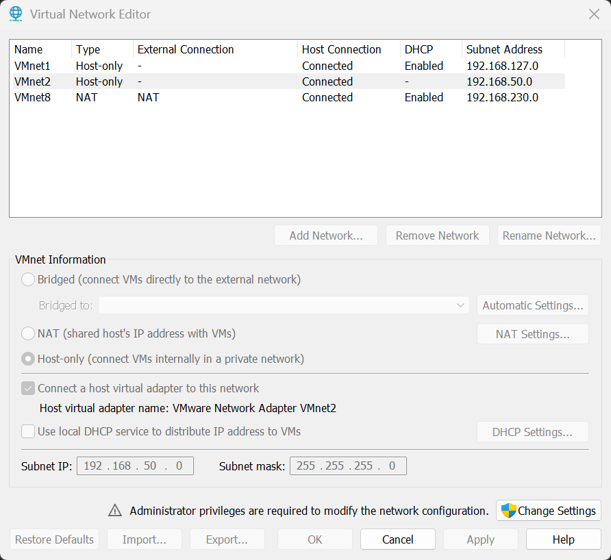
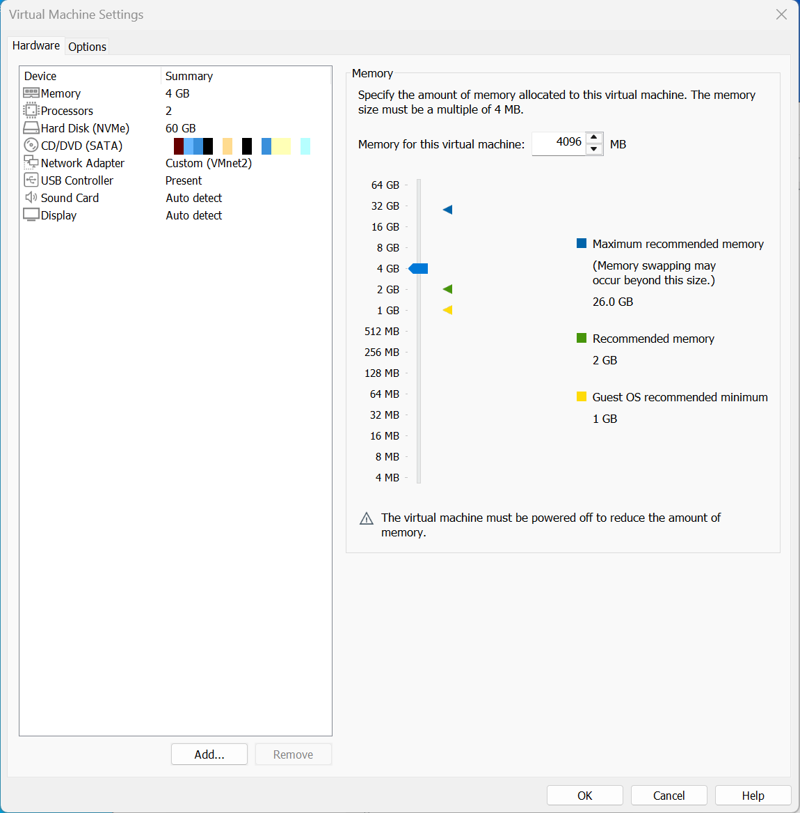
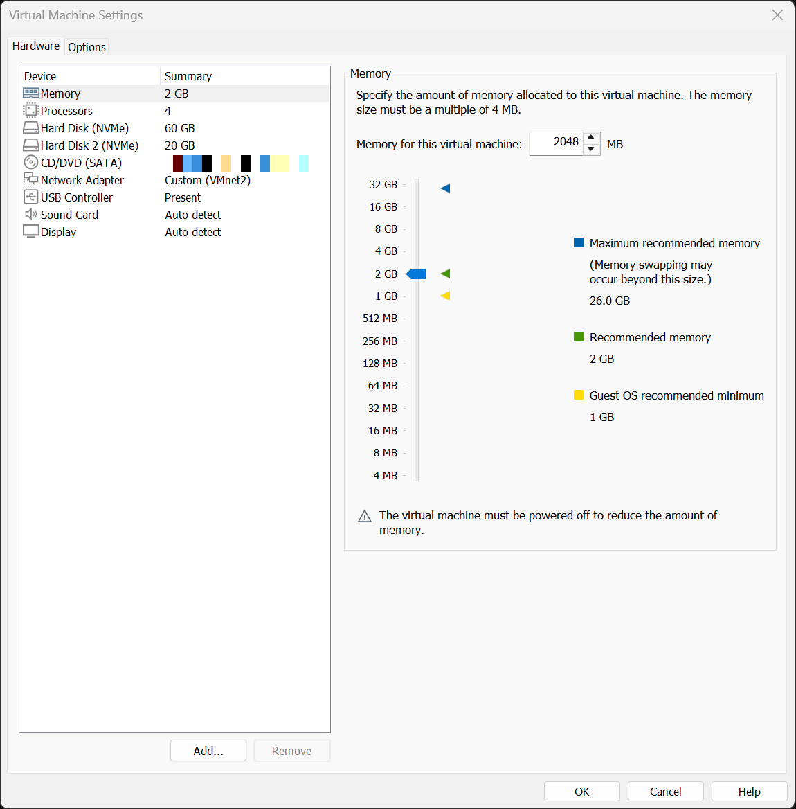
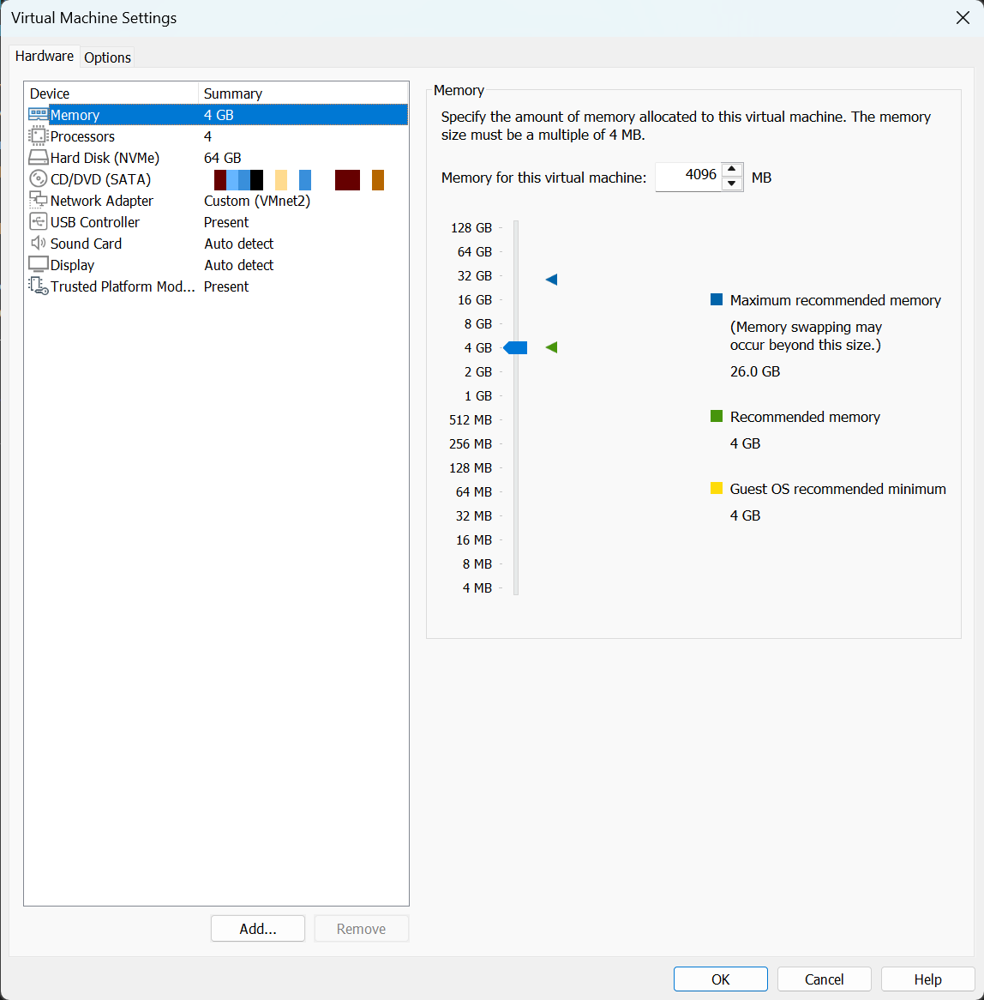
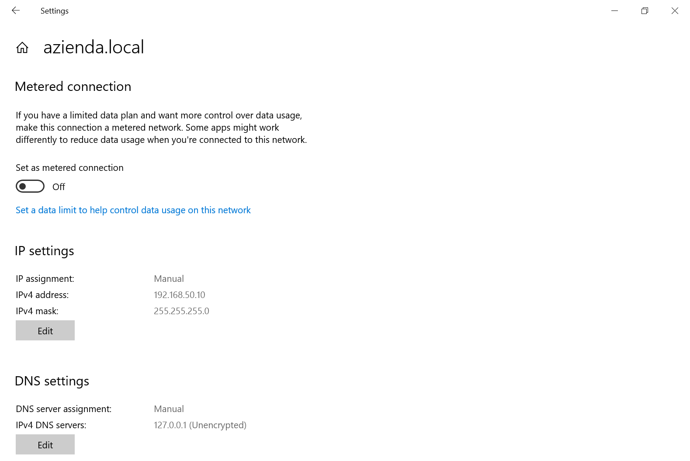
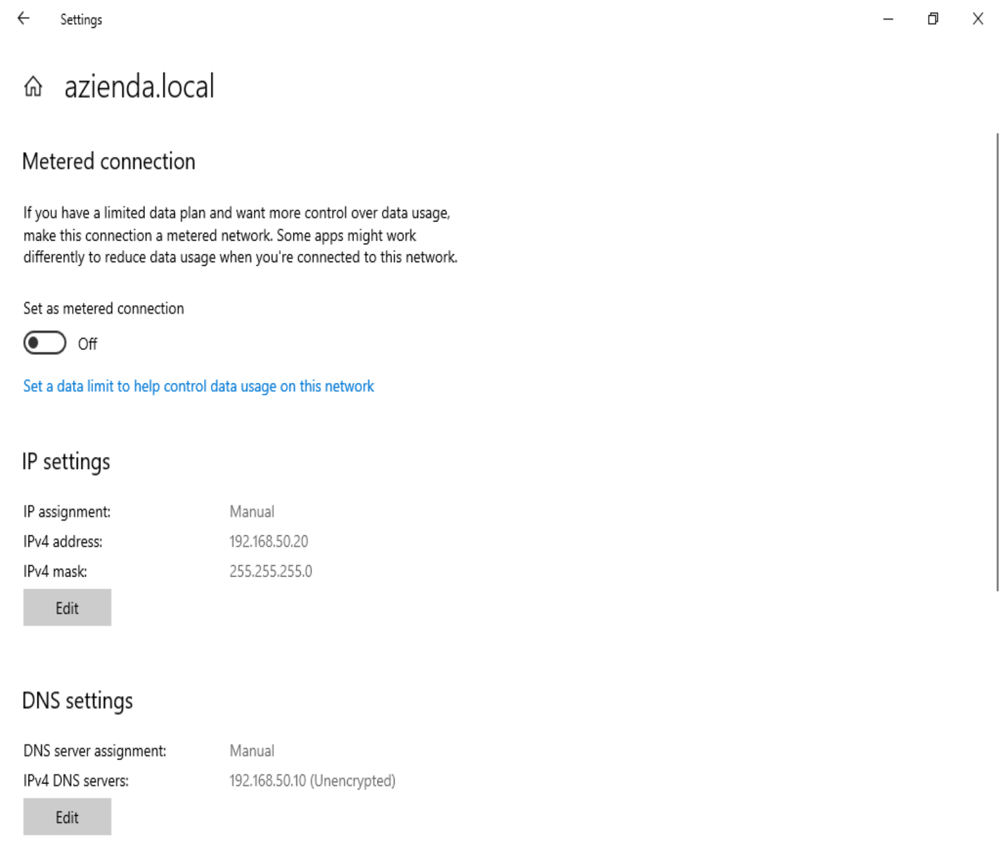
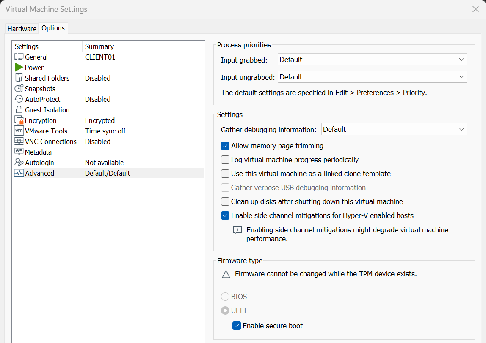

# Fase 1 - Infrastruttura

## Obiettivo
Predisporre una rete virtuale isolata e le macchine virtuali del laboratorio.

## Rete virtuale
La rete è definita con il Virtual Network Editor di VMware Workstation:

- rete `VMnet2` di tipo **host-only**
- **DHCP di VMware disattivato**: il servizio DHCP è erogato dal domain controller
- subnet `192.168.50.0/24`, maschera `255.255.255.0`

Nell'elenco, `VMnet2` risulta di tipo Host-only con la colonna DHCP vuota (servizio disattivato) e subnet `192.168.50.0`. Le altre reti (`VMnet1`, `VMnet8`) sono quelle predefinite di VMware e non sono utilizzate dal laboratorio.

## Piano degli indirizzi

| Host | Indirizzo | Note |
|---|---|---|
| DC01 | 192.168.50.10 | IP statico, DNS impostato su 127.0.0.1 |
| FS01 | 192.168.50.20 | IP statico, DNS impostato su 192.168.50.10 |
| CLIENT01 | DHCP | Range 192.168.50.100-200 |

Non è configurato alcun gateway: la rete è host-only e il laboratorio è isolato da Internet.

## Macchine virtuali

| VM | CPU | RAM | Disco | Rete |
|---|---|---|---|---|
| DC01 | 2 | 4 GB | 60 GB | VMnet2 |
| FS01 | 4 | 2 GB | 60 GB + 20 GB (dati) | VMnet2 |
| CLIENT01 | 4 | 4 GB | 64 GB | VMnet2 |

Le immagini ISO provengono dal Microsoft Evaluation Center: Windows Server 2022 e Windows 11 Enterprise. In VMware le macchine sono elencate come `DC1`, `FS01` e `CLIENT01`; il nome host Windows del domain controller è `DC01`.

Impostazioni hardware di DC01 (il percorso del file ISO è oscurato):

Impostazioni hardware di FS01, con il secondo disco da 20 GB destinato ai dati:

Impostazioni hardware di CLIENT01, con il modulo TPM virtuale richiesto da Windows 11:

## Installazione di Windows Server
- VM creata in modalità **Custom (advanced)** con l'opzione **"I will install the operating system later"**; l'ISO viene collegato manualmente. Questo evita l'installazione automatica di VMware (Easy Install), che con le ISO di valutazione genera un errore (vedi [troubleshooting](../07-troubleshooting/README.md)).
- Edizione: **Standard Evaluation (Desktop Experience)**
- Tipo di installazione: Custom, su disco da 60 GB

## Configurazione iniziale di DC01
- IP statico `192.168.50.10/24`, senza gateway, DNS `127.0.0.1`

Anche FS01 usa un indirizzo statico (`192.168.50.20/24`), con DNS puntato al domain controller (`192.168.50.10`):

Impostazioni di DC01:
- Rinomina del computer in `DC01`
- Installazione dei VMware Tools

## Note su Windows 11
- Firmware UEFI con Secure Boot e TPM virtuale (requisiti di Windows 11). Con il TPM presente il firmware non è più modificabile.
- Disco di almeno 64 GB
- In assenza di Internet l'installazione richiede un account locale (opzione "Domain join instead")

