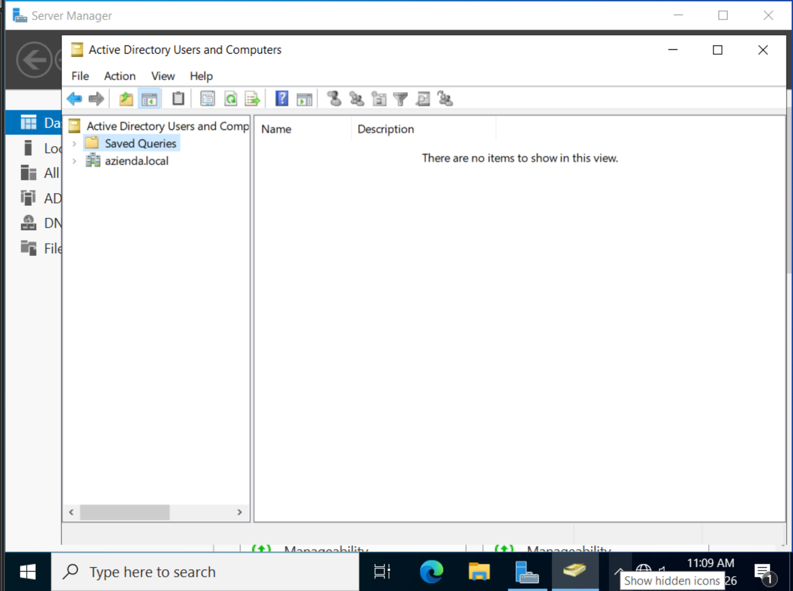
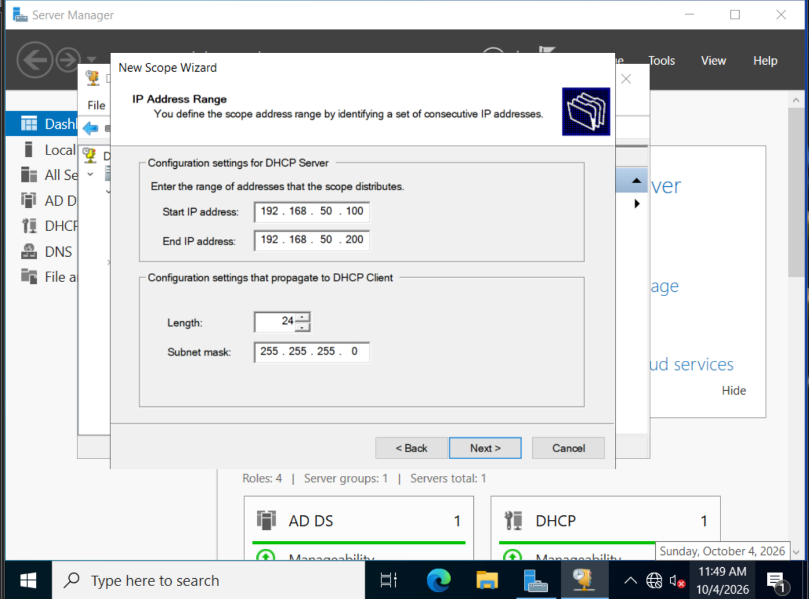
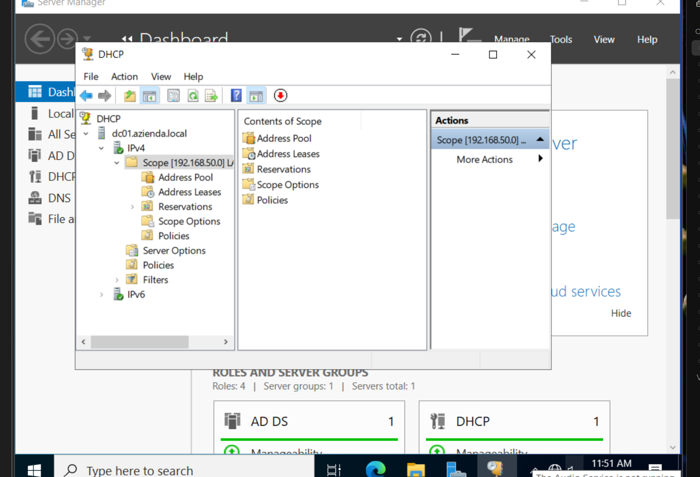
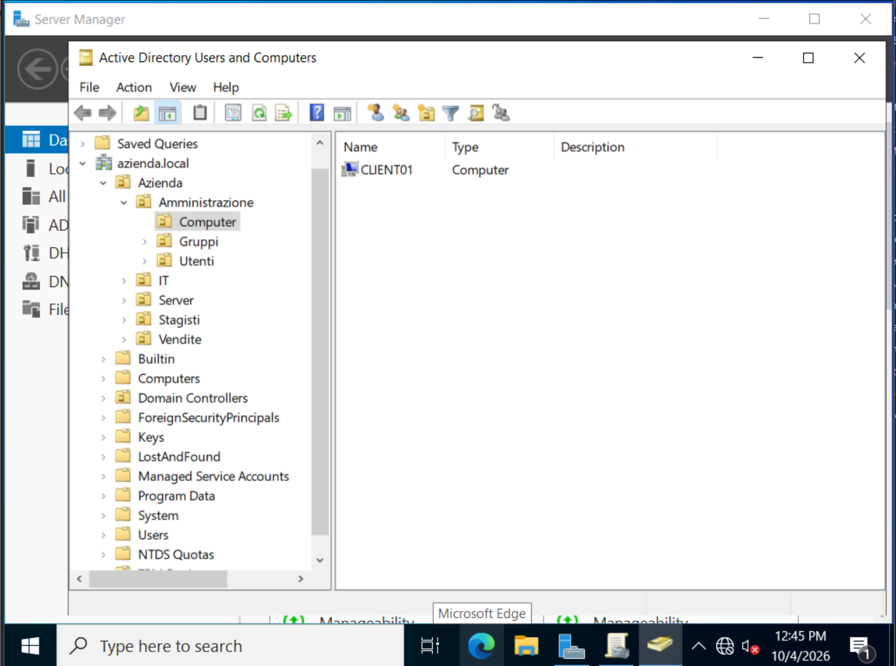

# Fase 2 - Active Directory, DNS e DHCP

## Obiettivo
Creare il dominio `azienda.local` e integrare i client.

## Installazione dei ruoli su DC01
Tramite *Server Manager > Manage > Add Roles and Features* sono installati i ruoli **Active Directory Domain Services** e **DNS Server**.

## Promozione a domain controller
- Creazione di una nuova foresta (**Add a new forest**) con dominio radice `azienda.local`
- Livelli funzionali di default
- Password DSRM (Directory Services Restore Mode) impostata
- Avviso sulla delega DNS: ignorato, comportamento atteso in un nuovo dominio
- Nome NetBIOS: `AZIENDA`
- Riavvio automatico e accesso come `AZIENDA\Administrator`

Il dominio risulta visibile in *Active Directory Users and Computers*.



## DHCP
Il ruolo **DHCP Server** è installato su DC01 e autorizzato in Active Directory (*Complete DHCP configuration*).

Scope `LAN-Azienda`:

| Parametro | Valore |
|---|---|
| Range | 192.168.50.100 - 192.168.50.200 |
| Maschera | /24 |
| Lease | 8 giorni (default) |
| Gateway | non impostato (rete host-only) |
| DNS | 192.168.50.10 |
| Dominio DNS | azienda.local |



Lo scope risulta attivo e `IPv4` mostra la spunta verde nella console DHCP.



## Join dei client al dominio
Il client riceve indirizzo e DNS dal DHCP. Prima del join la configurazione è verificata con:

```
ipconfig /all
nslookup azienda.local
```

`nslookup` deve risolvere `azienda.local` con `192.168.50.10`. Il join avviene da `sysdm.cpl > Change...`, indicando il dominio `azienda.local` e le credenziali `AZIENDA\Administrator`, seguito da riavvio.

Verifiche successive:
- in `ipconfig /all` il campo **DHCP Server** è `192.168.50.10`
- nella console DHCP, *Scope > Address Leases*, compare il client
- l'accesso con un utente di dominio (`AZIENDA\utente`) ha esito positivo

I computer uniti al dominio vengono creati di default nel contenitore `Computers` e vanno spostati nella OU di competenza. `CLIENT01` è stato spostato in `Amministrazione > Computer`:


