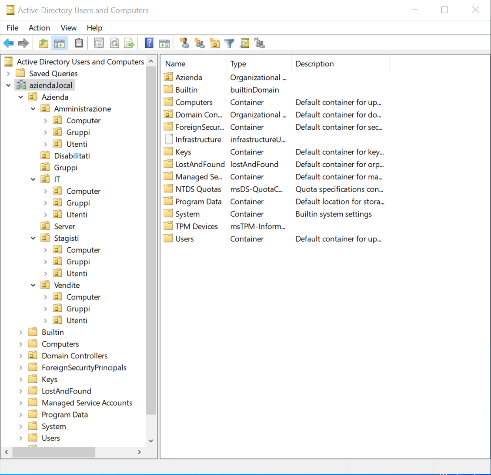
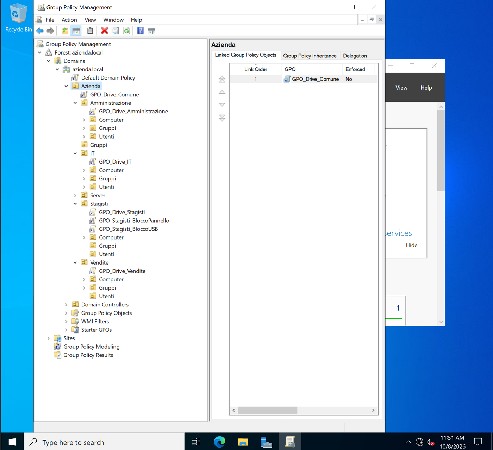

# Fase 3 - OU, utenti e gruppi

## Struttura delle OU

```
azienda.local
└── Azienda
    ├── Amministrazione (Utenti, Computer, Gruppi)
    ├── Vendite         (Utenti, Computer, Gruppi)
    ├── IT              (Utenti, Computer, Gruppi)
    ├── Stagisti        (Utenti, Computer, Gruppi)
    ├── Disabilitati    (account disattivati dall'offboarding, Fase 6)
    ├── Server
    └── Gruppi          (gruppi trasversali, es. DL_Comune_RW)
```

La struttura vista da *Active Directory Users and Computers*:



Le OU sono create con la protezione contro la cancellazione accidentale attiva. La schermata seguente, ottenuta da Group Policy Management, mostra la struttura completa con le GPO collegate, descritte nella [Fase 4](../04-gpo/README.md).



## Gruppi di sicurezza
Per ogni reparto è presente un gruppo **Global** nella relativa OU `Gruppi`:

`GG_Amministrazione`, `GG_Vendite`, `GG_IT`, `GG_Stagisti` (Scope: Global, Type: Security)

## Utenti
Per ogni reparto sono presenti due utenti nella OU `Utenti`, ciascuno membro del gruppo `GG_` del proprio reparto. La password iniziale è impostata con l'opzione **"User must change password at next logon"**.

Utenti usati nei test (nomi di fantasia):

| Utente | Reparto |
|---|---|
| l.verdi (Luca Verdi) | Vendite |
| p.bassi (Paola Bassi) | Vendite |
| m.rossi (Marco Rossi) | Amministrazione |
| a.fonti (Andrea Fonti) | Stagisti |

Ulteriori utenti sono creati in modo automatico con lo script PowerShell descritto nella [Fase 6](../06-powershell-ssh/README.md).

## Modello AGDLP
**A**ccount -> **G**lobal group -> **D**omain **L**ocal group -> **P**ermission

- Il gruppo Global (`GG_`) raccoglie le **persone** di un reparto
- Il gruppo Domain Local (`DL_`) rappresenta il **permesso** su una risorsa
- I permessi NTFS sono assegnati esclusivamente ai gruppi `DL_`

Il vantaggio è che la modifica dell'accesso di un utente si ottiene variandone l'appartenenza ai gruppi, senza intervenire sui permessi delle cartelle.

Il suffisso `_RW` o `_R` nel nome indica il livello di permesso previsto (Modify o Read) ed è solo una convenzione: il permesso effettivo è quello assegnato sulla cartella.

I gruppi `DL_` per i permessi del file server sono descritti nella [Fase 5](../05-file-server/README.md).
