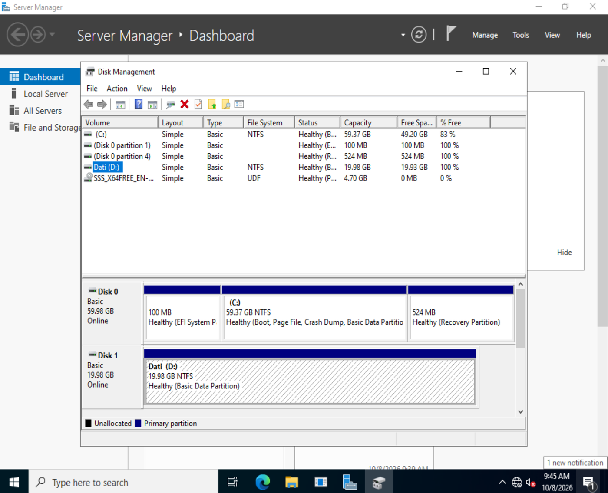
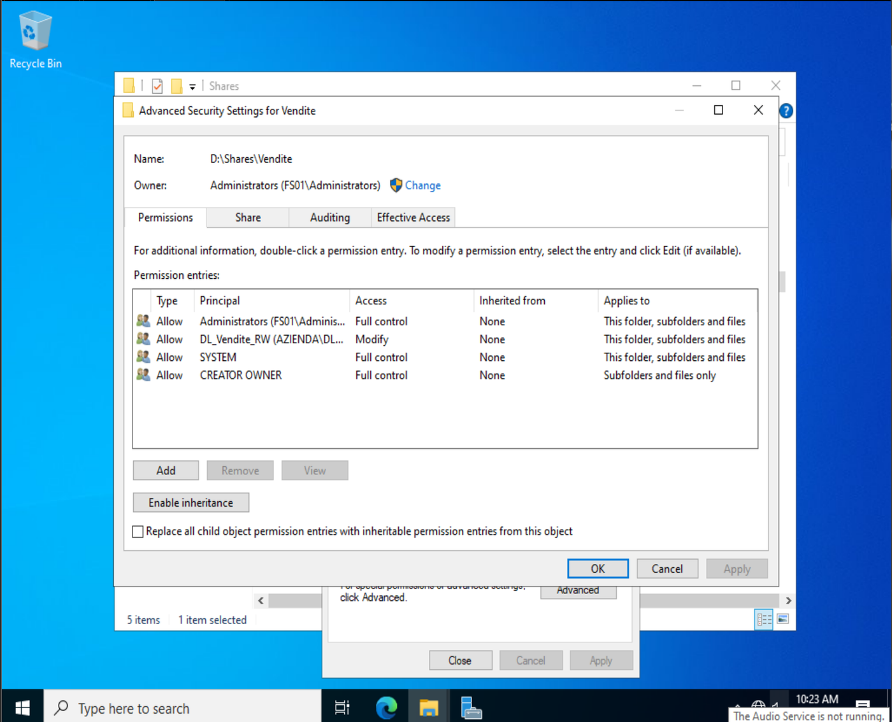
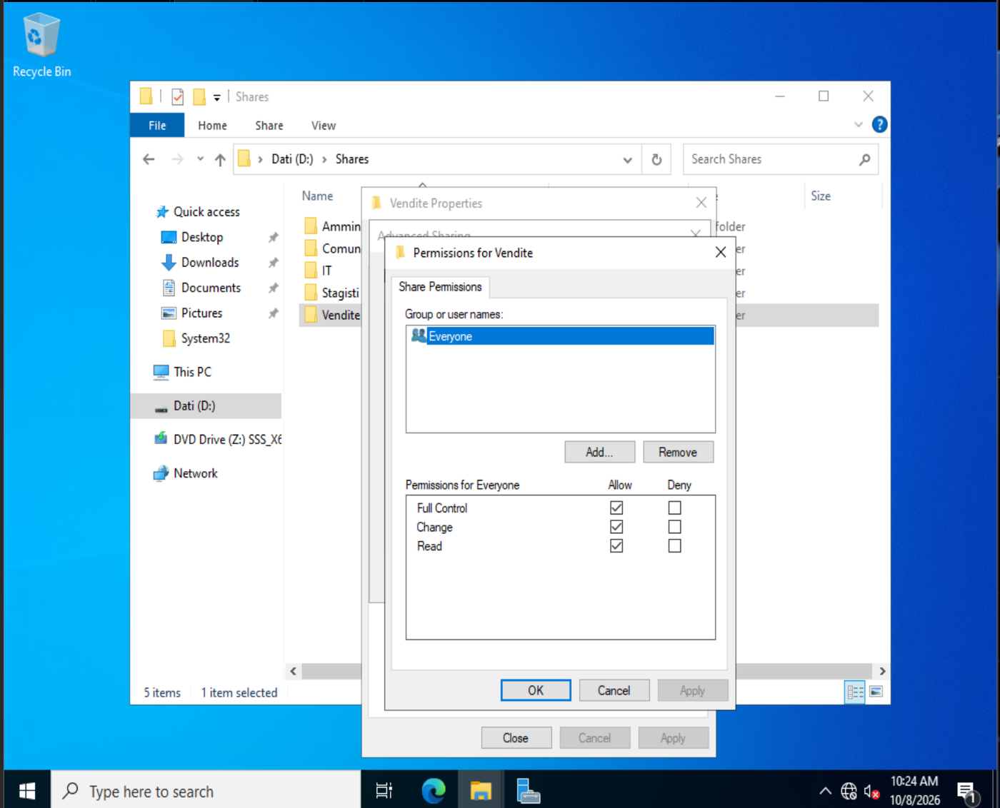
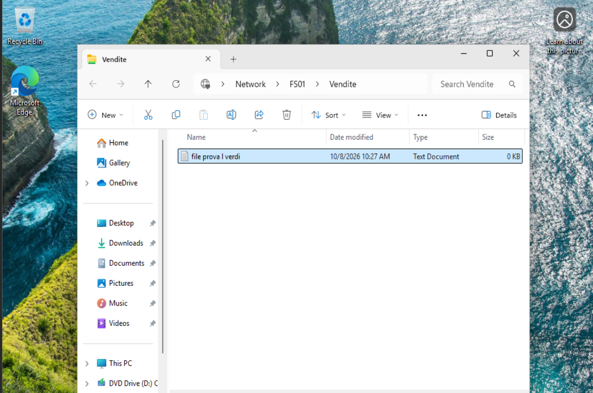
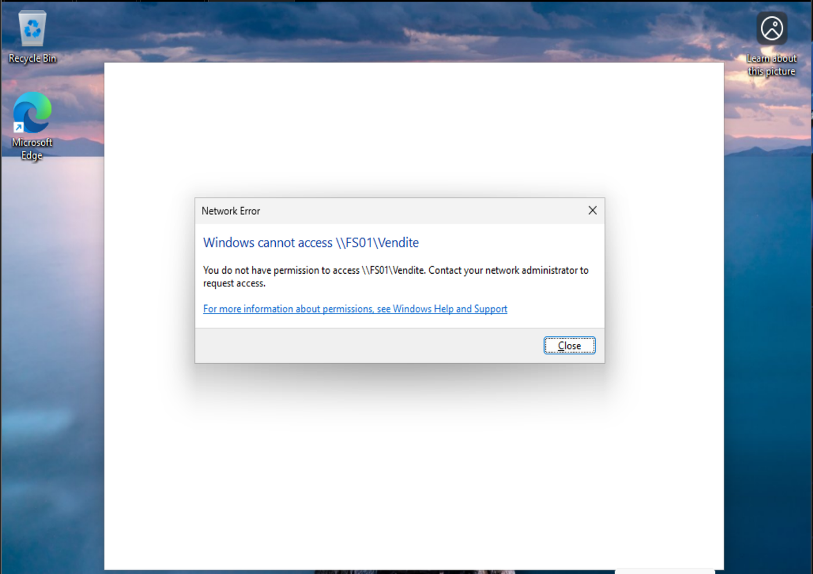
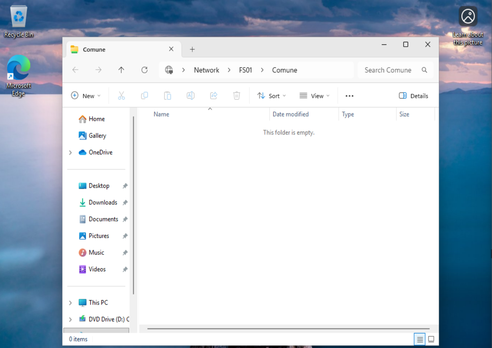
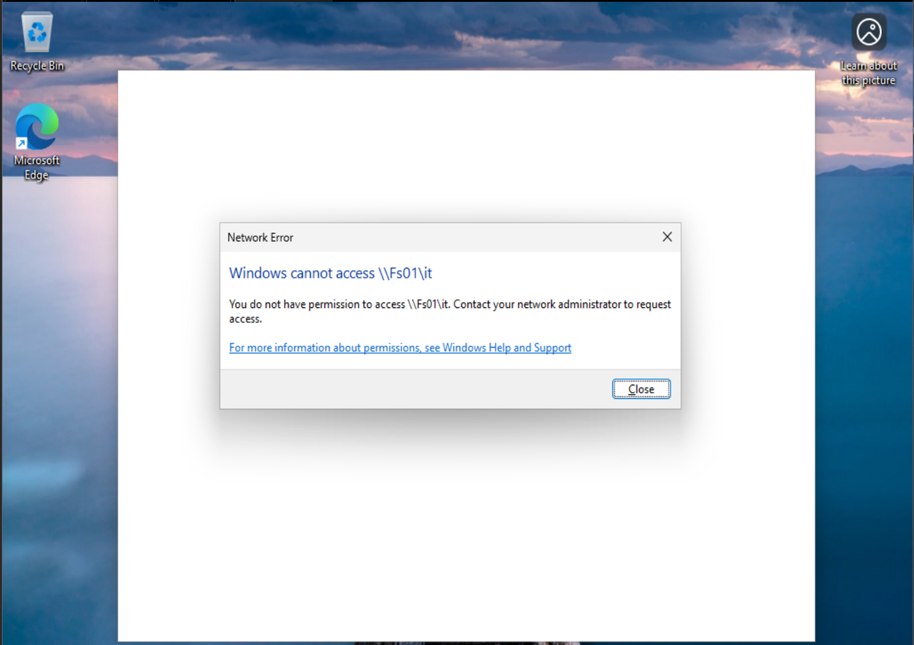

# Fase 5 - File server (FS01)

## Preparazione di FS01
- FS01 (Windows Server 2022, `192.168.50.20`) unito al dominio e spostato nella OU `Azienda > Server`
- Ruolo **File Server** e **File Server Resource Manager** (utile per le quote, previste in una fase successiva)
- Secondo disco da 20 GB: inizializzato GPT, volume NTFS con etichetta `Dati`. La lettera `D:` era occupata dall'unità DVD di installazione, riassegnata a `Z:`



## Struttura delle cartelle
```
D:\Shares
├── Amministrazione
├── Vendite
├── IT
├── Stagisti
└── Comune
```

## Permessi per reparto (modello AGDLP)

| Cartella | Gruppo Domain Local | Membro | Permesso NTFS |
|---|---|---|---|
| Amministrazione | DL_Amministrazione_RW | GG_Amministrazione | Modify |
| Vendite | DL_Vendite_RW | GG_Vendite | Modify |
| IT | DL_IT_RW | GG_IT | Modify |
| Stagisti | DL_Stagisti_RW | GG_Stagisti | Modify |
| Comune | DL_Comune_RW | tutti i quattro GG_ | Modify |

**1. Gruppi di permesso (su DC01)**
I gruppi Domain Local (Security) sono creati nella OU `Gruppi` del reparto e contengono come membro il relativo `GG_`. `DL_Comune_RW`, che non appartiene a un singolo reparto, risiede nella OU `Gruppi` sotto `Azienda` e contiene tutti e quattro i gruppi `GG_`.

**2. Permessi NTFS (su FS01), per ciascuna cartella**
- ereditarietà disabilitata, con conversione dei permessi ereditati in espliciti
- rimozione dei gruppi `Users` (e `Authenticated Users`, se presente)
- mantenimento di `SYSTEM`, `Administrators`, `CREATOR OWNER`
- assegnazione al gruppo `DL_` del reparto del permesso **Modify**

Esempio per `Vendite`: nessuna ereditarietà, `DL_Vendite_RW` con Modify.



**3. Condivisione**
Ogni cartella è condivisa come `\\FS01\<Nome>` con permessi di condivisione `Everyone: Full Control`. Il controllo degli accessi è delegato ai permessi NTFS, poiché l'accesso effettivo è il più restrittivo tra permessi di condivisione e NTFS.



## Verifiche da CLIENT01

| Utente | Reparto | Percorso | Risultato |
|---|---|---|---|
| l.verdi | Vendite | `\\FS01\Vendite` | Accesso consentito, creazione di file riuscita |
| m.rossi | Amministrazione | `\\FS01\Vendite` | Access is denied |
| l.verdi | Vendite | `\\FS01\Comune` | Accesso consentito |
| l.verdi | Vendite | `\\FS01\IT` | Accesso negato |

File creato in `\\FS01\Vendite` da un utente di Vendite:



Accesso a `\\FS01\Vendite` da un utente di un altro reparto:



Accesso a `\\FS01\Comune` da un utente di Vendite:



Accesso a `\\FS01\IT` dallo stesso utente, che non appartiene a IT:



Catena dei permessi: utenti -> `GG_<Reparto>` -> `DL_<Reparto>_RW` -> Modify sulla cartella.

Le unità di rete che puntano a queste condivisioni sono mappate dalle GPO descritte nella [Fase 4](../04-gpo/README.md).
