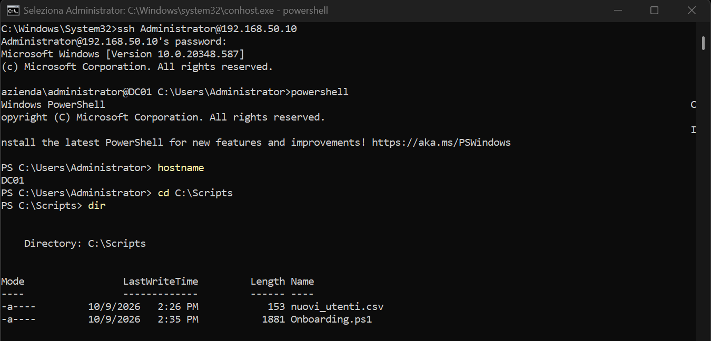
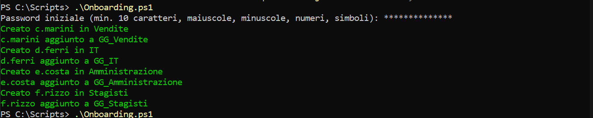
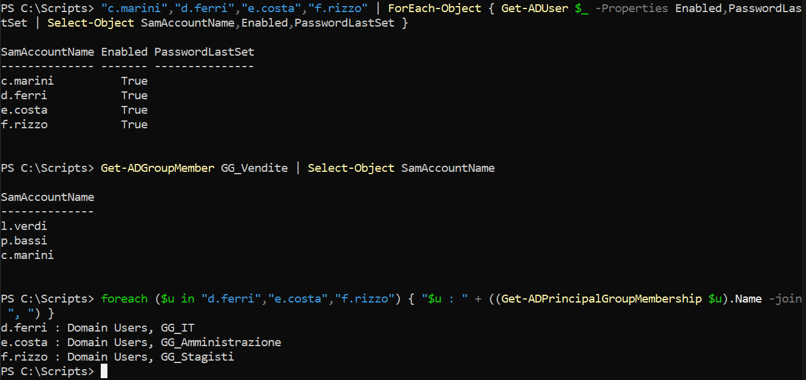
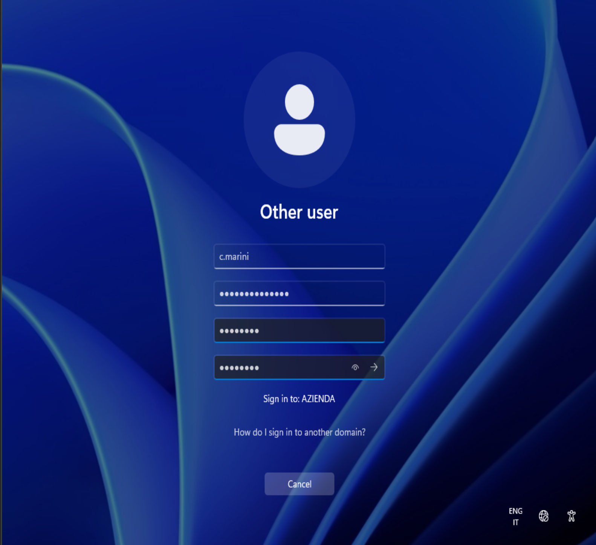
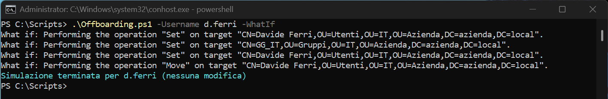
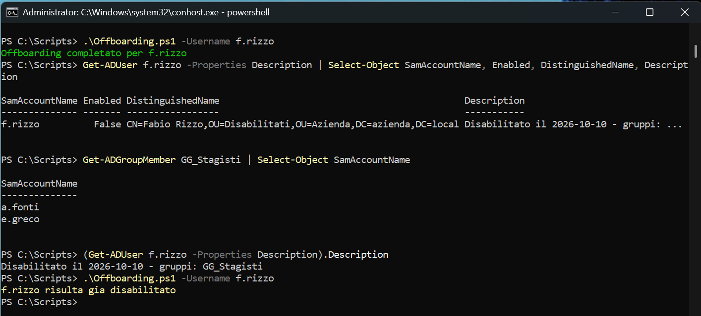

# Fase 6 - Automazione con PowerShell e accesso remoto via SSH

## Obiettivo
Automatizzare il ciclo di vita degli utenti con script PowerShell (onboarding da file CSV e offboarding) e amministrare DC01 da remoto con OpenSSH.

## Accesso remoto con OpenSSH
Su DC01 il server OpenSSH è installato come funzionalità opzionale di Windows ed eseguito come servizio:

```powershell
Add-WindowsCapability -Online -Name OpenSSH.Server~~~~0.0.1.0
Set-Service sshd -StartupType Automatic
Start-Service sshd
Get-NetFirewallRule -Name *ssh*
```

L'installazione crea la regola firewall `OpenSSH-Server-In-TCP` (porta 22). La connessione dal PC host avviene attraverso la rete host-only `VMnet2`, senza necessità di ulteriori schede di rete:

```
ssh Administrator@192.168.50.10
powershell
```

La sessione SSH si apre in `cmd`; il comando `powershell` avvia la shell PowerShell, riconoscibile dal prompt che inizia con `PS`. I cmdlet di PowerShell non sono disponibili in `cmd` (vedi [troubleshooting](../07-troubleshooting/README.md)).



I file sono trasferiti dal PC host con `scp`:

```
scp Onboarding.ps1 nuovi_utenti.csv Administrator@192.168.50.10:C:/Scripts/
```

Nota di sicurezza: nel laboratorio l'autenticazione avviene con password. In un ambiente di produzione è preferibile l'autenticazione a chiave pubblica.

## Script di onboarding
File: [`scripts/Onboarding.ps1`](scripts/Onboarding.ps1). Input: [`scripts/nuovi_utenti.csv`](scripts/nuovi_utenti.csv), con colonne `Nome`, `Cognome`, `Username`, `Reparto` (nomi di fantasia).

Per ogni riga del CSV lo script:
1. determina la OU di destinazione `OU=Utenti,OU=<Reparto>,OU=Azienda,...`
2. crea l'utente con `New-ADUser`, impostando il cambio password al primo accesso
3. aggiunge l'utente al gruppo `GG_<Reparto>`

Scelte progettuali:
- **Idempotenza**: se l'utente esiste già viene segnalato e saltato; l'appartenenza al gruppo è verificata separatamente, quindi una seconda esecuzione completa anche eventuali assegnazioni mancanti.
- **Gestione degli errori**: blocchi `try/catch` con `-ErrorAction Stop`. Se la creazione fallisce a metà (ad esempio per una password non conforme alla policy) l'utente parziale viene rimosso.
- **Gestione della password**: richiesta a video come `SecureString`; non è memorizzata nel codice né nel repository.

La prima esecuzione crea gli utenti e li inserisce nei gruppi:



## Verifica
Tramite `Get-ADUser`, `Get-ADGroupMember` e `Get-ADPrincipalGroupMembership` si accerta che gli utenti siano abilitati e appartengano ai gruppi previsti. Il valore vuoto di `PasswordLastSet` è atteso, perché la password deve ancora essere cambiata al primo accesso.



## Test dal client
L'utente `c.marini` accede a `CLIENT01`; al primo accesso Windows richiede il cambio della password.



Essendo membro di `GG_Vendite`, l'utente riceve dalle GPO della [Fase 4](../04-gpo/README.md) le unità `V:` (Vendite) e `Z:` (Comune). Il risultato è identico a quello di un utente creato manualmente.


## Script di offboarding
File: [`scripts/Offboarding.ps1`](scripts/Offboarding.ps1). Lo script gestisce l'uscita di un dipendente senza eliminare l'account, in modo da conservarne lo storico. Per l'utente indicato con il parametro `-Username`:
1. registra nella descrizione la data e i gruppi di appartenenza (traccia per eventuali verifiche o ripristini)
2. rimuove l'utente dai gruppi
3. disabilita l'account
4. sposta l'oggetto nella OU `Disabilitati`

La OU di destinazione è stata creata con protezione dalla cancellazione accidentale:

```powershell
New-ADOrganizationalUnit -Name "Disabilitati" -Path "OU=Azienda,DC=azienda,DC=local" -ProtectedFromAccidentalDeletion $true
```

Scelte progettuali:
- **Supporto a `-WhatIf`** (`SupportsShouldProcess`): l'opzione mostra le operazioni previste senza eseguirle ed è utile come controllo preventivo su un'operazione che modifica più oggetti. Al termine, il messaggio distingue la simulazione dall'esecuzione reale.
- **Idempotenza**: se l'utente si trova già nella OU `Disabilitati`, lo script lo segnala e non esegue alcuna modifica.
- **Gestione degli errori**: blocco `try/catch` con `-ErrorAction Stop`.

Simulazione su un utente attivo (`d.ferri`): sono elencate le quattro operazioni e non viene modificato nulla.



Esecuzione reale su `f.rizzo`, verifica dello stato finale (account disabilitato, OU `Disabilitati`, utente rimosso da `GG_Stagisti`, descrizione con data e gruppi) e seconda esecuzione, che non produce modifiche:


