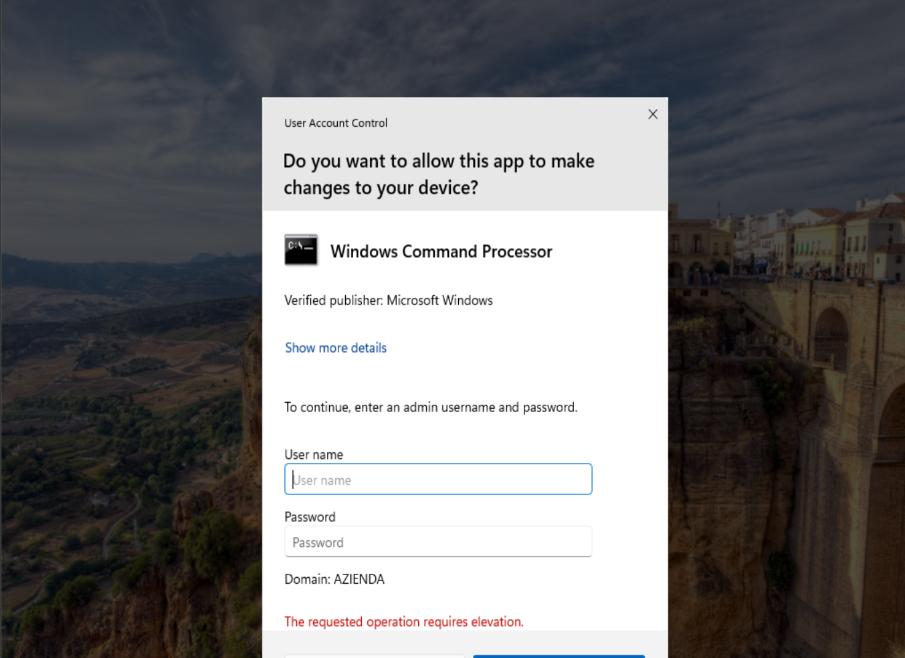
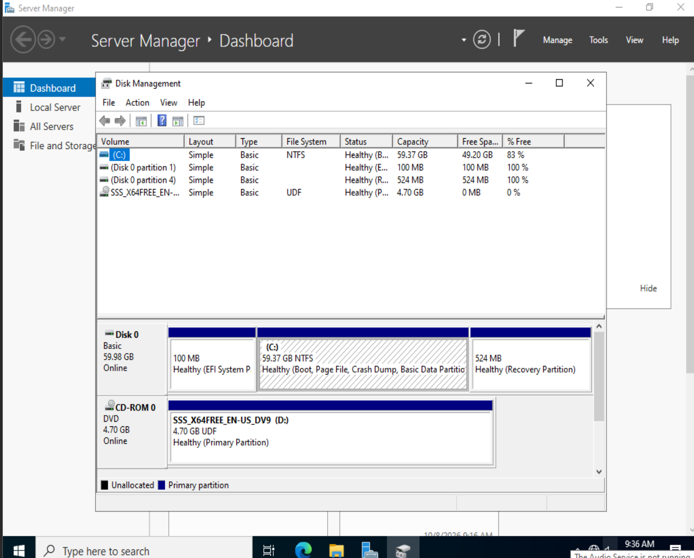
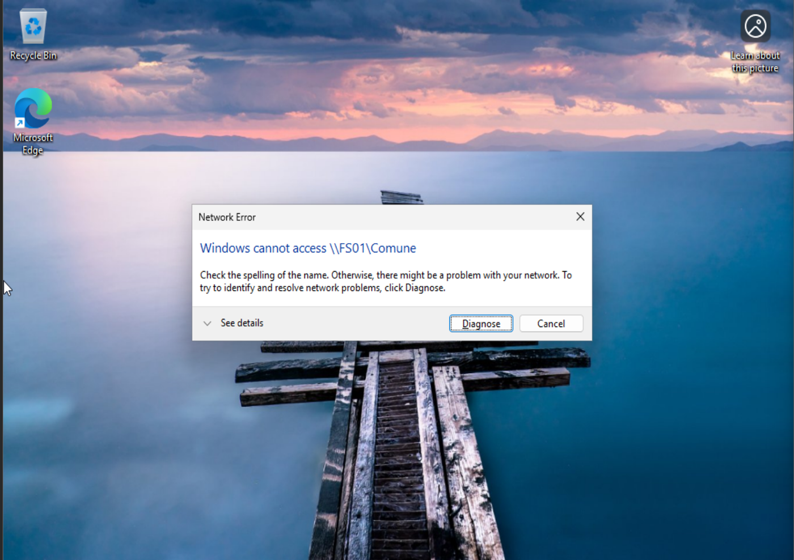
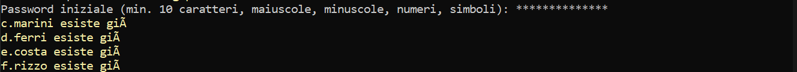

# Troubleshooting: problemi incontrati

Raccolta dei problemi effettivamente riscontrati durante la realizzazione del laboratorio, con causa e risoluzione.

## 1. "Windows cannot find the Microsoft Software License Terms" durante l'installazione
- **Causa**: installazione automatica di VMware (Easy Install) con ISO di valutazione, oppure ISO danneggiato.
- **Risoluzione**: Ricreazione della VM con l'opzione **"I will install the operating system later"** e collegamento manuale dell'ISO. Verifica dell'integrità dell'ISO con `Get-FileHash`.

## 2. La VM si ferma sul Boot Manager UEFI
- **Causa**: il prompt "Press any key to boot from CD or DVD" non ha ricevuto alcun input entro il timeout.
- **Risoluzione**: selezionare *EFI VMware Virtual SATA CDROM Drive* dal boot manager e premere un tasto immediatamente.

## 3. Un'OU non si può eliminare
- **Causa**: protezione contro la cancellazione accidentale attiva.
- **Risoluzione**: attivare *View > Advanced Features*, aprire le Properties dell'OU, scheda **Object**, e deselezionare *Protect object from accidental deletion*. In alternativa da PowerShell: `Set-ADObject -ProtectedFromAccidentalDeletion $false` e `Remove-ADOrganizationalUnit`.

## 4. L'utente standard apre il prompt e compare la richiesta di credenziali admin



- **Causa**: comportamento corretto (UAC). L'utente di dominio non ha diritti di amministratore.
- **Risoluzione**: per i test aprire `cmd` normalmente (Win + R) e usare `gpresult /r /scope user`.

## 5. Il secondo disco non compare in Disk Management



- **Causa**: il disco non era collegato alla VM.
- **Risoluzione**: aggiungere l'hard disk da *VM > Settings* a VM spenta, inizializzarlo (GPT) e creare il volume. La lettera `D:` era occupata dal DVD di installazione e il volume è stato riassegnato a `Z:` con *Change Drive Letter and Paths*.

## 6. "Windows cannot access \\FS01\Comune"



- **Causa**: la cartella non era ancora condivisa (errore di rete, non di permessi).
- **Risoluzione**: verificare con `Get-SmbShare` su FS01 e condividere la cartella con *Advanced Sharing*. Distinzione utile: "cannot access ... check the spelling" indica che la condivisione non esiste, "Access is denied" indica un problema di permessi.

## 7. "is not recognized as an internal or external command" con i comandi PowerShell
- **Causa**: il comando è stato digitato in `cmd` e non in PowerShell. Succede anche con SSH, che apre `cmd` di default.
- **Risoluzione**: digitare `powershell` e controllare che il prompt inizi con `PS`. Attenzione anche ai refusi (`OpensSSH`, `Get/NetFirewallRule` con la barra al posto del trattino).

## 8. Utenti creati dallo script ma disabilitati, o senza gruppo
- **Causa**: la password iniziale non rispettava la password policy del dominio (min. 10 caratteri, complessità). `New-ADUser` crea comunque l'oggetto, ma disabilitato, e la fase del gruppo non veniva ripetuta.
- **Risoluzione**: script riscritto con `try/catch`, pulizia degli utenti parziali e controllo del gruppo separato dalla creazione (idempotenza). Utenti rotti eliminati e script rieseguito.

## 9. Caratteri accentati rovinati nell'output dello script ("giÃ")



- **Causa**: file salvato in UTF-8 da Notepad e letto da PowerShell 5.1 con un'altra codifica.
- **Risoluzione**: nei messaggi dello script si evitano gli accenti (`gia`, `e'`). Alternativa: salvare il file come UTF-8 con BOM.

## 10. La VM CLIENT01 non si avvia: "File not found" sul disco virtuale
- **Causa**: un'estensione del `.vmdk` (file `-s006`) risultava mancante, quindi il disco era inutilizzabile.
- **Risoluzione**: VM ricreata da zero. Il vecchio oggetto computer in AD è stato eliminato prima del nuovo join, poi il nuovo `CLIENT01` è stato spostato in `Amministrazione > Computer`. Lezione: tenere una copia dei dischi o uno snapshot dopo le fasi importanti.

## 7. "is not recognized as an internal or external command" con cmdlet PowerShell
- **Causa**: il comando è stato eseguito in `cmd` anziché in PowerShell. Accade anche con SSH, che apre `cmd` come shell predefinita. Sono stati riscontrati inoltre refusi nei nomi dei cmdlet (`OpensSSH`, `Get/NetFirewallRule` con la barra al posto del trattino).
- **Risoluzione**: avviare `powershell` e verificare che il prompt inizi con `PS`; controllare la sintassi dei cmdlet.

## 8. Utenti creati dallo script ma disabilitati o privi di gruppo
- **Causa**: la password iniziale non rispettava la password policy del dominio (lunghezza minima 10, complessità). `New-ADUser` crea comunque l'oggetto, ma disabilitato, e la prima versione dello script non ripeteva l'assegnazione al gruppo.
- **Risoluzione**: script riscritto con `try/catch`, rimozione degli utenti parziali e verifica del gruppo separata dalla creazione (idempotenza). Gli utenti non validi sono stati eliminati e lo script rieseguito con una password conforme.

## 9. Caratteri accentati alterati nell'output dello script ("giÃ")


- **Causa**: file salvato in UTF-8 da Notepad e interpretato da Windows PowerShell 5.1 con una codifica diversa.
- **Risoluzione**: nei messaggi dello script sono stati evitati i caratteri accentati. In alternativa, salvare il file come UTF-8 con BOM.

## 10. La VM CLIENT01 non si avvia: "File not found" sul disco virtuale
- **Causa**: un'estensione del disco (`-s006.vmdk`) risultava mancante, rendendo il disco virtuale inutilizzabile.
- **Risoluzione**: VM ricreata da zero. L'oggetto computer preesistente in Active Directory è stato eliminato prima del nuovo join; il nuovo `CLIENT01` è stato quindi spostato in `Amministrazione > Computer`. Indicazione operativa: eseguire snapshot o copie dei dischi al termine delle fasi principali.

## 11. scp: "stat local ...: No such file or directory"
- **Causa**: `scp` cerca il file nella cartella corrente (nell'esempio `C:\Windows\System32`), non nella cartella in cui il file è stato salvato. Con la sincronizzazione di OneDrive attiva, inoltre, il Desktop si trova in `%USERPROFILE%\OneDrive\Desktop` e non in `%USERPROFILE%\Desktop`.
- **Risoluzione**: spostarsi nella cartella del file con `cd`, verificarne la presenza con `dir` e ripetere la copia. In caso di dubbio sul percorso, `dir /s /b "%USERPROFILE%\<nomefile>"` restituisce il percorso completo.

## Comportamenti attesi (non errori)

| Situazione | Perché è giusto così |
|---|---|
| Dispositivo USB visibile ma non apribile per gli Stagisti | La GPO nega l'accesso al contenuto, non nasconde il dispositivo |
| Un utente di un altro reparto riceve "Access is denied" su una cartella di reparto | Non fa parte del gruppo `GG_` corrispondente |
| Le unità di rete non compaiono dopo `gpupdate` | Le Preferences si applicano al logon |
| `PasswordLastSet` vuoto su un utente appena creato | La password deve ancora essere cambiata al primo accesso |
| `PasswordLastSet` vuoto su un utente appena creato | Deve ancora cambiare la password al primo accesso |

## Comandi di diagnostica

```
ipconfig /all
nslookup azienda.local
gpupdate /force
gpresult /r /scope user
whoami
Get-SmbShare
Unlock-ADAccount -Identity <utente>
```
