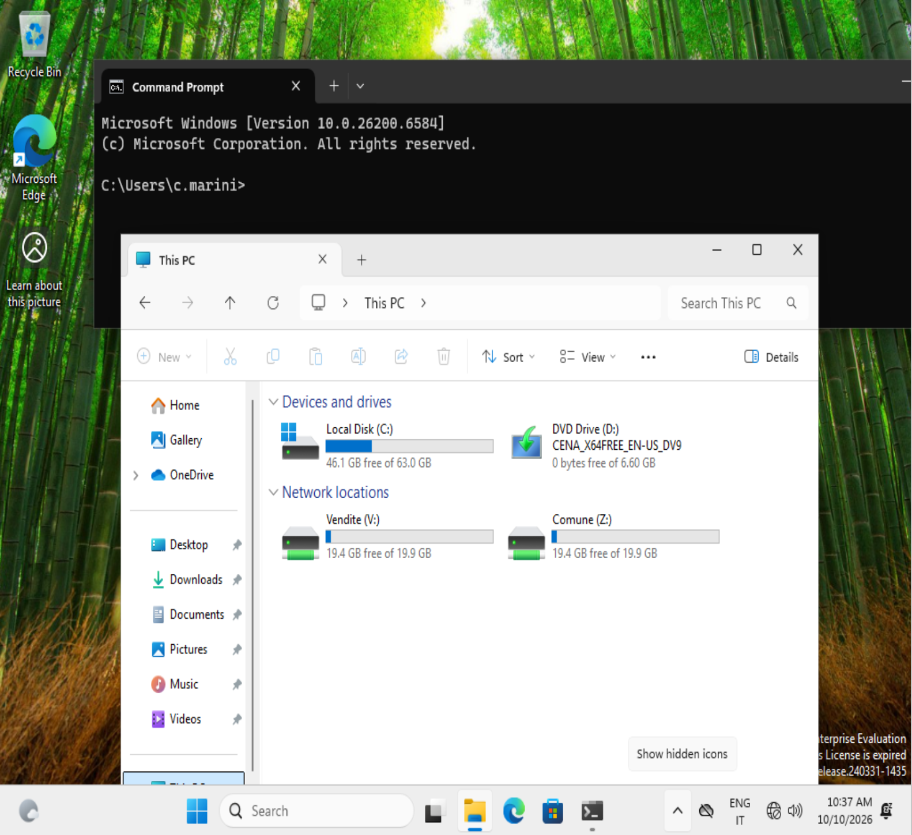

# Enterprise Windows Lab: Active Directory, GPO e File Server

Laboratorio virtuale per la pratica sull'amministrazione di un'infrastruttura Windows aziendale: dominio Active Directory, DNS/DHCP, struttura di OU, Group Policy, file server con permessi per reparto. Ogni fase è documentata con le procedure adottate, gli screenshot di verifica e i problemi riscontrati.

## Competenze coperte

- Windows Server 2022: installazione e configurazione
- Active Directory Domain Services, DNS, DHCP
- Organizational Unit, utenti, gruppi (modello AGDLP)
- Group Policy (GPO): password policy e blocco account, restrizioni utente, blocco USB, mappatura delle unità di rete
- Windows 11 Enterprise: join al dominio e test delle policy
- File server: permessi NTFS e di condivisione
- PowerShell: onboarding utenti da CSV e offboarding (idempotenti, con gestione errori e `-WhatIf`) e amministrazione remota con OpenSSH
- Troubleshooting (`gpresult`, `gpupdate`, `nslookup`, `ipconfig`, `Unlock-ADAccount`)

## Architettura

| VM | Sistema | IP | Ruolo |
|---|---|---|---|
| DC01 | Windows Server 2022 | 192.168.50.10 | Domain controller, DNS, DHCP |
| FS01 | Windows Server 2022 | 192.168.50.20 | File server |
| CLIENT01 | Windows 11 Enterprise (Evaluation) | DHCP (192.168.50.100-200) | Client di dominio |

- Dominio: `azienda.local` (NetBIOS: `AZIENDA`)
- Hypervisor: VMware Workstation
- Rete: `VMnet2`, host-only, DHCP di VMware disattivato (il DHCP è quello di DC01)

```
          VMnet2 (host-only) 192.168.50.0/24
   ------------------------------------------------
        |                |                 |
     DC01              FS01            CLIENT01
  .10  AD DS/DNS/DHCP  .20  File server  DHCP .100-.200
```

## Documentazione per fase

Ogni fase ha una propria cartella con documentazione e screenshot di verifica.

| Fase | Contenuto | Stato |
|---|---|---|
| [01 - Infrastruttura](01-infrastruttura/README.md) | Rete virtuale, VM, piano degli indirizzi | Completata |
| [02 - Active Directory, DNS e DHCP](02-active-directory-dns-dhcp/README.md) | Dominio, DHCP, join dei client | Completata |
| [03 - OU, utenti e gruppi](03-ou-utenti-gruppi/README.md) | Struttura aziendale e modello AGDLP | Completata |
| [04 - Group Policy](04-gpo/README.md) | Password policy, restrizioni, unità di rete | Completata |
| [05 - File server](05-file-server/README.md) | Cartelle condivise e permessi per reparto | Completata |
| [06 - PowerShell e SSH](06-powershell-ssh/README.md) | Onboarding e offboarding utenti, accesso remoto | Completata |
| [07 - Troubleshooting](07-troubleshooting/README.md) | Problemi riscontrati e risoluzioni | In aggiornamento |

## Risultato in breve

Un utente creato dallo script (`c.marini`, Vendite), dopo il login, trova da solo l'unità del suo reparto (`V:`) e quella comune (`Z:`), mappate dalle GPO:



Le GPO sono collegate alle OU giuste e ogni reparto riceve solo le proprie:


## Prossimi passi

- [x] Script PowerShell: creazione utenti da CSV ([06-powershell-ssh/scripts](06-powershell-ssh/scripts/))
- [x] Script PowerShell: offboarding con spostamento in OU dedicata
- [ ] Script PowerShell: report degli account inattivi, inventario dei client
- [ ] GPO: redirect delle cartelle, orari di accesso, AppLocker, delega del controllo all'helpdesk
- [ ] Quote con FSRM
- [ ] Modulo VMware ESXi (anche nested)
- [ ] Parte SOC: Sysmon + Wazuh, attacchi simulati, detection, incident report

Nota: nel repository non ci sono password o credenziali.
